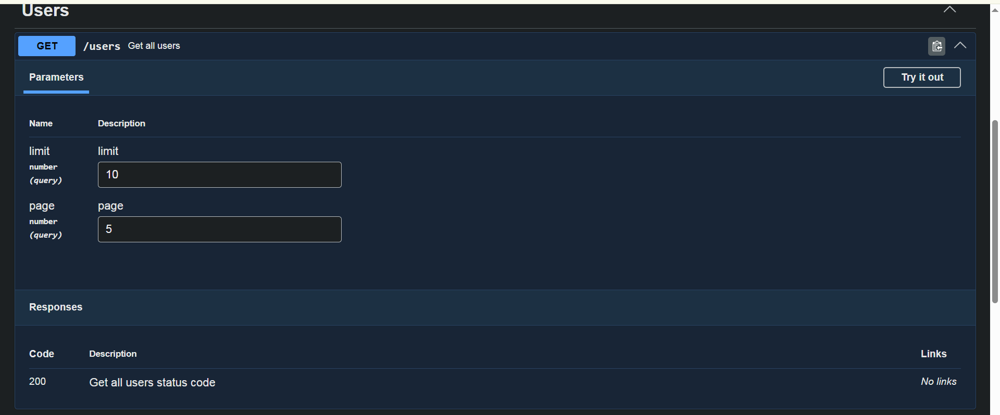

# Nest Basic

### Global install Nest
First of all, you have to install nest cli in your local machine.
```
npm i -g @nestjs/cli
```

### Create Nest Product
```
nest new project-name

```

### Nest Help
If you forget any command line, go this.
```
nest --help
```

### Data Transfer Object (DTO)
Dto is for validation. before using dto, install this
```
npm i --save class-validator class-transformer
```

### Global Pipe line
If you want to call Dto in controller, you have to use Validation Pipe.
eg.
```
@Post()
    createUser(@Body(new ValidationPipe()) body:CreateUserDto){ 
        console.log(body);
        return "create user endpoint";
    }
```
အဲ့လိုဆိုရင် သုံးချင်တဲ့ Controller request ချင်းဆီတိုင်း လိုက်ထည့်နေရမှာ ဖြစ်တဲ့အတွက် global သုံးလို့ ရအောင်လုပ်မယ်

So in main.ts, we call useGlobalPipes like that.
```
import { NestFactory } from '@nestjs/core';
import { AppModule } from './app.module';
import { ValidationPipe } from '@nestjs/common';

async function bootstrap() {
  const app = await NestFactory.create(AppModule);
  app.useGlobalPipes(new ValidationPipe({
    whitelist: true,
    forbidNonWhitelisted: true,
    transform: true
  }));
  await app.listen(process.env.PORT ?? 3000);
}
bootstrap();

```

What is whitelist: true, forbidNonWhitelisted: true,transform: true ?
1-whitelist: true
Eg. Body ကနေ request ပို့တယ်ဆိုပါစို့။ လိုတာက name နဲ့ email ဘဲ။ ဒါပေမယ့် အပို request အနေနဲ့ တခြားတခုခု eg phone လို့ထည့်လိုက်ရင် phone ကို ပါ လက်ခံနေမယ် အဲ့ဒါကြောင့် whitelist: true ကို ထည့်တာ ။ whitelist: true ကို ထည့်ထားရင် မလိုတာ ဘယ်လောက်ထည့်ထည့် လိုတဲ့ request ဘဲ ယူမယ် 
DTO မှာ validation decorator မရှိတဲ့ extra properties တွေကို request data ထဲကနေ ဖယ်ရှားပေးတယ်။

2- forbidNonWhitelisted: true
မလိုတဲ့ request ပို့လည်း backend က ဆက်အလုပ်လုပ်နေတယ်ဆိုတာ မဖြစ်သင့်ဘူး အဲ့ဒါကြောင့် forbidNonWhitelisted: true ကို ထည့်တာ
whitelist မဝင်တဲ့ extra properties တွေ ပါလာရင် အဲဒီ properties တွေကို ဖယ်ပြီး ဆက်မလုပ်ဘဲ validation error နဲ့ request ကို reject လုပ်တယ်။

3- transform:true
Request data ကို DTO/class type နဲ့ အလုပ်လုပ်နိုင်အောင် transform လုပ်ပေးမယ်
eg. /users?age=25
HTTP ကနေဝင်လာတဲ့ query parameter တွေဟာ အများအားဖြင့် string ဖြစ်ပါတယ်။ "25"
ဒါပေမယ့် application ထဲမှာ 25 number လိုချင်နိုင်တယ်
transform: true က ဒီလို type conversion / DTO transformation တွေအတွက် အရေးကြီးပါတယ်


### Params in Dto
```
@Get(":id")
    detailUser(@Param() getUserDto:GetUserDto){
        console.log(getUserDto);
        return "detail user endpoint";
}
```
and this is Dto
```
import { Type } from "class-transformer";
import { IsInt, IsNotEmpty } from "class-validator";

export class GetUserDto{
    @IsNotEmpty()
    @IsInt()
    @Type(() => Number)
    id:number
}
```

Why use this? @Type(() => Number)
In params, it will always take string. 
Eg. http://localhost:3000/users/234234
234234 is string. But we want integer. So we use @Type(() => Number) from class-transformer

### Nest js Mapped types
```
npm i @nestjs/mapped-types
```
Why use this?
CreateUserDto မှာ အကုန်လူံး data တွေ ဖြည့်ဖို့လိုတယ် but PatchUserDto မှာ တော့ အကုန်လူံး optional လုပ်ချင်တယ် data တွေကို အစအဆုံး ပြန်မရေးချင်ဘူး ဆိုရင် သုံးတယ်
Eg.
```
import { PartialType } from "@nestjs/mapped-types";
import { CreateUserDto } from "./create.user.dto";

export class PatchUserDto extends PartialType(CreateUserDto){
}
```
PatchUserDto မှာ CreateUserDto ကို extends ခေါ်ပီး install လုပ်ထားတဲ့ mapped-types ထဲက PartialType ကို ခေါ်ပီး အုပ်ပေးရုံဘဲ

### Dependency Injection (DI)
First create service.ts inside providers folder
eg. providers/user.service.js

Eg.
```
import { Injectable } from "@nestjs/common";

@Injectable()
export class UserService{
    getAllUser(){
        return [
            {
                id:1,
                name:"John Doe"
            },
            {
                id:2,
                name:"asdf efwe"
            },
            {
                id:3,
                name:"2wesdv sdfdv"
            }
        ]
    }
}
```

And then connect in related module. Now I'm creating user service.
So connect in user module.
```
import { Module } from '@nestjs/common';
import { UsersController } from './users.controller';
import { UserService } from './providers/user.service';

@Module({
  controllers: [UsersController],
  providers:[UserService]
})
export class UsersModule {}

```

And then can use in controller
Eg.
```
export class UsersController {
    constructor(private readonly userService:UserService){}
    @Get()
    getUsers() {
        return this.userService.getAllUser();    
    }
}
```

### Note
ပုံမှန်ဆို service  cli နဲ့ generate လုပ်လို့ရပေမယ့် project structure ပိုကောင်းအောင် service ကို providers folder အောက်မှာ ထည့်ကြတယ်။ အဲ့လိုမျိုး provider အောက်ရအောင် လုပ်လို့ရတယ်
```
nest g service posts/providers/posts --flat
```

### Export and import Service
Eg. If you want to use user service in post service, at first you have to export user service from user module.
Eg.
```
import { Module } from '@nestjs/common';
import { UsersController } from './users.controller';
import { UserService } from './providers/user.service';

@Module({
  controllers: [UsersController],
  providers:[UserService],
  exports:[UserService]
})
export class UsersModule {}

```

And then you have to import in post module.
Important note
You have to import user module in post module. not import user service
Eg.
```
import { Module } from '@nestjs/common';
import { PostsController } from './posts.controller';
import { PostsService } from './providers/posts.service';
import { UsersModule } from 'src/users/users.module';

@Module({
  controllers: [PostsController],
  providers: [PostsService],
  imports:[UsersModule]
})
export class PostsModule {}

```

### Circular Dependency
ကိုယ့်မှာက module တွေ တစ်ခုထပ်ပိုရှိနေမယ် ရှိတဲ့ module ရဲ့ service တွေကိုလည်း တခြား နေရာမှာ သုံးချင်တယ်ဆိုရင် export လုပ်တာက ပုံမှန်အတိုင်းဆိုပေမယ့် import ကို အရင်လို လုပ်လို့မရဘူး အရင်လိုလုပ်ရင် error တက်မယ်။ အဲ့ဒါကြောင့် forwardRef ထဲမှာ callback function ခေါ်ပီးထည့်
Eg.
```
import { forwardRef, Module } from '@nestjs/common';
import { UsersController } from './users.controller';
import { UserService } from './providers/user.service';
import { AuthModule } from 'src/auth/auth.module';

@Module({
  controllers: [UsersController],
  providers:[UserService],
  exports:[UserService],
  imports:[forwardRef(() => AuthModule)]
})
export class UsersModule {}
```

ပီးရင် ကိုယ်ခေါ်သုံးချင်တဲ့နေရာမှာလည်း  contractor ထဲမှာ inject လုပ်ပေးပီး forwardRef ထဲမှာ callback function ခေါ်ပီး ထည့်ပေးရမယ်
```
constructor(
        @Inject(forwardRef(() => AuthService))
        private readonly authService:AuthService
){}
```

### Swagger
Swagger is for client document ui.
```
npm i @nestjs/swagger
```
And then setup swagger in main.ts
```
import { NestFactory } from '@nestjs/core';
import { AppModule } from './app.module';
import { ValidationPipe } from '@nestjs/common';
import { DocumentBuilder, SwaggerModule } from '@nestjs/swagger';

async function bootstrap() {
  const app = await NestFactory.create(AppModule);
  app.useGlobalPipes(new ValidationPipe({
    whitelist: true,
    forbidNonWhitelisted: true,
    transform: true
  }));

  // Swagger
  const config = new DocumentBuilder()
                    .setTitle("NestJS Basic")
                    .setDescription("This is NestJS Basic Description")
                    .setVersion("1.0").build();
  const document = SwaggerModule.createDocument(app,config)
  SwaggerModule.setup("api-doc",app,document)
  await app.listen(process.env.PORT ?? 3000);
}
bootstrap();
```
First of all, you have to setup config and call DocumentBuilder from swagger
and set version as you like and make build
```
const config = new DocumentBuilder().setVersion("1.0").build();
```
And then in DocumentBuilder, there is many feature like setTitle, setDescription etc.

And then create document
```
const document = SwaggerModule.createDocument(app,config)
```
createDocument received app and config. When you hover createDocument, it will show you like that

```
(method) SwaggerModule.createDocument(app: INestApplication, config: Omit<OpenAPIObject, "paths">, options?: SwaggerDocumentOptions): OpenAPIObject
```
And then finally setup
```
SwaggerModule.setup("api-doc",app,document)
```

Also you hover setup, it will show you what they need.
```
(method) SwaggerModule.setup(path: string, app: INestApplication, documentOrFactory: OpenAPIObject | (() => OpenAPIObject), options?: SwaggerCustomOptions): void
```
And then run server and check in http://localhost:3000/api-doc

Also we can add eg. note in swagger in each api end point like that.
```
@Get()
@ApiOperation({summary:"Get all users"})
@ApiResponse({status:200,description:"Get all users status code"})
@ApiQuery({
    name:"limit",
    type:"number",
    required:false,
    description:"limit",
    example:10
})
@ApiQuery({
    name:"page",
    type:"number",
    required:false,
    description:"page",
    example:5
})
getUsers(
    @Query('limit',new DefaultValuePipe(10),ParseIntPipe) limit:number,
    @Query('page',new DefaultValuePipe(5),ParseIntPipe) page:number
) {
    return this.userService.getAllUser(limit,page);    
}
```
Eg. 


If controller use Dto, you have to use @ApiProperty in Dto
```
export class GetUserDto{
    @ApiProperty({example:1,description:"user id"})
    @IsNotEmpty()
    @IsInt()
    @Type(() => Number)
    id:number
}
```
other @ApiOperation and @ApiResponse can use in controller.

### compodoc for developer ui
```
npm i @compodoc/compodoc
```

And then create command in package.json

```
"scripts": {
    "doc": "npx @compodoc/compodoc -p tsconfig.json -s --port 3001 --watch -d ./docs"
  },
```

And then you can run and check with that port. It will auto create doc ui for your project.

In there, there is documentation coverage and all statements show 0%. why?
ဘာလို့လဲဆိုတော့ သူက ကိုယ်ရေးထားတဲ့ code ကို comment ခံပီး code ရဲ့ အဓိပ္ပာယ်ကို ရှင်းပြစေချင်တာ

Eg.
src/app.controller.ts  |    controller  |   AppController   |	0 % (0/2)

သူ့ရဲ့ အဓိပ္ပာယ်က ဒီ controller ထဲမှာ ရေးထားတဲ့ method or function နှစ်ခုရှိတယ် အဲ့နှစ်ခုရဲ့ အဓိပ္ပာယ်ကို မရှင်းပြထားဘူး အဲ့ဒါကြောင့် 0% ဖြစ်နေတာ

So this is original app controller
```
import { Controller, Get } from '@nestjs/common';
import { AppService } from './app.service';

@Controller()
export class AppController {
  constructor(private readonly appService: AppService) {}

  @Get()
  getHello(): string {
    return this.appService.getHello();
  }
}

```
to this
```
import { Controller, Get } from '@nestjs/common';
import { AppService } from './app.service';

/** This is App Controller */
@Controller()
export class AppController {
  constructor(private readonly appService: AppService) {}

  /** This is Get Hello from app service */
  @Get()
  getHello(): string {
    return this.appService.getHello();
  }
}
```
Comment ကို ဒီကြားထဲ ထည့်
```
/** you can add what you want */
```


